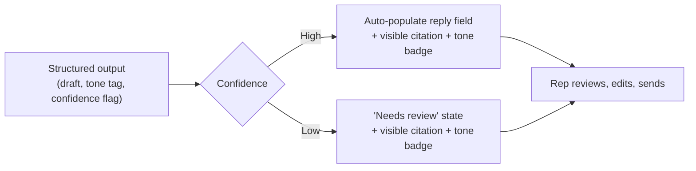

# Contextual AI Experience Design

> Where an AI feature appears, what it's allowed to read automatically, and how it shows its sourcing decide whether people actually trust and use it — these are product and UX decisions, not side effects of model quality.

*Scenario: Northbeam, a fictional mid-market B2B SaaS company. Illustrative, not based on any employer's data. Continues the ticket-drafting assistant from `prompt-vs-context.md`.*

## 1. Problem

Northbeam support reps now have an AI assistant that drafts ticket replies with structured output — a draft, a tone tag, and a confidence flag. But reps can't tell what a draft is actually based on. That produces two bad outcomes at once: some reps accept drafts blindly because the text reads fluently, others rewrite every draft from scratch because they don't trust any of it. Neither behavior is what the feature was built for, and the gap isn't model quality — it's that nothing in the experience shows a rep what the model saw or how sure it was.

## 2. Product decision

Three UX commitments, made deliberately rather than left to default:

| Decision | Option taken | Option rejected |
|---|---|---|
| Where it appears | Inline in the existing ticket view | A separate "AI assistant" chat tab |
| How it sources claims | A visible one-line citation on any factual or policy claim | Free text with no sourcing, trusting the rep to verify independently |
| How confidence is shown | The Day-6 confidence flag rendered as a visible cue that gates behavior | Treating all drafts the same regardless of confidence |

The common thread: don't let the model's fluency substitute for showing the rep where an answer came from and how sure the system is. A confident-sounding draft and an uncertain one should never look identical in the UI.

## 3. How the system works

- The assistant stays **inline in the ticket view** the rep is already working in — no separate surface to open, no context-switch.
- Every factual or policy claim in a draft carries a **citation** pulled from the context bundle (e.g., "Source: Refund Policy v3") — reusing content the model already had, not a new retrieval step.
- The **confidence flag** from Day 6's structured output now drives UI behavior directly: high-confidence drafts auto-populate the reply field for review; low-confidence drafts are flagged "needs review" and withheld from auto-insert.
- The **tone tag** renders as a small inline badge so a rep can tell at a glance whether the draft matches the ticket's register before reading the full text.

The design principle underneath both branches: the rep never acts on an answer without seeing its source and its confidence — the only thing that changes is how much the system does automatically before handing control back.

## 4. Risks and trade-offs

- **Citation UI adds real engineering cost** to a feature that started as "just call the model and insert the text" — it's no longer a thin wrapper.
- **Over-citing clutters the interface** and can train reps to stop reading citations at all, which defeats the point.
- **A miscalibrated confidence cue is worse than no cue** — if "high confidence" doesn't reliably correlate with a correct answer, the UI actively teaches reps to over-trust.
- **Inline placement assumes the ticket view is the right home** — if reps work across many tools, inline-only can mean the assistant simply isn't present where a rep happens to be.

## 5. How I would measure success

- **Edit-depth distribution on drafts** — the target is a healthy middle (reps editing meaningfully), not 0% (blind acceptance) or 100% (no trust at all).
- **Citation click-through rate** — whether reps actually use the sourcing to verify, or ignore it.
- **Override rate on the confidence flag** — how often reps act against what the cue suggests, which signals whether the cue itself is calibrated correctly.

---
**Related:** `02-prompt-context-design/prompt-vs-context.md`
