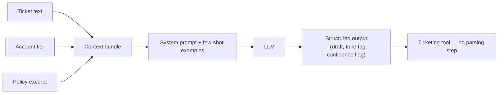

# Prompt vs Context

> Most "the AI isn't working" bug reports are a prompt-or-context diagnosis problem, not a model-quality problem — and running that diagnosis is a skill a PM can own, not one that has to go back to engineering first.

*Scenario: Northbeam, a fictional mid-market B2B SaaS company. Illustrative, not based on any employer's data.*

## 1. Problem

Northbeam support reps use an AI assistant to draft replies to customer tickets. It sometimes ignores the tone and format rules support leads set for it — a reply comes back too casual, or in plain prose when the ticketing tool expects a structured draft. The team's first instinct is to escalate it as "the model isn't good enough" and ask engineering to swap in a better one. That instinct skips a cheaper, faster question: what did the model actually see when it produced that answer?

## 2. Product decision

Before any inconsistency gets escalated as a model-quality issue, require a standard diagnostic pass that separates three different problems that look identical from the outside:

| Looks like | Actually is | Fix |
|---|---|---|
| Model "ignored" an instruction | Prompt problem — the instruction was ambiguous or buried | Rewrite the instruction, don't swap the model |
| Model answer is inconsistent across similar tickets | Context problem — each ticket's context bundle differs (missing policy text, stale account data, too much irrelevant history) | Fix what's fed in, not how it's asked |
| Model genuinely can't do the task reliably even with a clear prompt and clean context | Model-capability limit | Only now is "better model" the right ask |

Paired with that: any assistant output that feeds back into the ticketing system must return structured output (a fixed schema — draft text, tone tag, confidence flag) instead of free text. Free text is cheap to generate and expensive to parse reliably downstream; a schema turns the output into something a workflow can consume without a human eyeballing format every time.

## 3. How the system works

- A **system prompt** sets the assistant's role, tone, and boundaries once, persisting for the session — it's the main lever to change behavior without touching the model.
- Each ticket's **context bundle** is deliberately narrow: the current ticket text, account tier, and a short policy excerpt — not the full interaction history. Context is a budget, not a free add-on; every extra token competes for the model's attention and costs money and latency.
- **2-3 few-shot examples** anchor the reply format and tone, paid for in tokens.
- The model returns **structured JSON** (draft, tone tag, confidence flag) so the ticketing tool can insert the draft without a parsing step.

When a rep reports a bad reply, the diagnostic pass checks this pipeline in order: was the instruction clear (prompt), was the right information actually in the bundle (context), and only then — was this beyond the model's capability.

## 4. Risks and trade-offs

- **Few-shot examples add tokens, cost, and latency**, and too many can overfit tone to one persona instead of generalizing.
- **Structured output improves reliability but can flatten nuance** — a rep's edge-case reply might need more explanation than a fixed schema leaves room for.
- **A narrow context bundle controls cost but risks missing something relevant** — an earlier interaction the model never saw, that would have changed the answer.
- **The diagnostic habit itself can be skipped under pressure** — when a ticket is urgent, "just escalate to engineering" is the path of least resistance even when it's the wrong one.

## 5. How I would measure success

- **Share of AI-drafted replies sent with no formatting edits** — the direct signal that prompt/context design is working.
- **Rate of "AI quality" escalations that the diagnostic pass reclassifies as prompt or context issues** — should fall as the checklist gets used, showing fewer problems were actually model problems.
- **Schema-validation failure rate on structured output** — tracks whether the fixed-shape contract is actually holding up in production.

---
**Related:** `01-ai-product-foundations/choosing-the-right-intelligence-layer.md`
