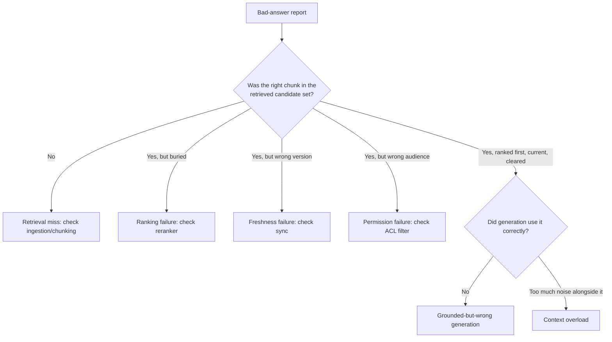

# RAG Failure Modes: "Bad AI Answer" Is at Least Six Different Bugs

> Every RAG failure gets reported the same way — "the AI got it wrong" — but retrieval miss, ranking failure, staleness, permission leak, hallucination, and context overload have six different root causes and six different fixes; treating them as one bug is how teams burn a sprint fixing the wrong layer.

*Scenario: Northbeam (fictional company). Illustrative, not based on any employer's data.*

## 1. Problem

Northbeam's ticket-drafting assistant now has hybrid search, reranking, permission-aware retrieval, and freshness sync (Days 8-9). It still occasionally produces a wrong-feeling draft, and when a rep flags one, the investigation starts from zero every time — engineering, support leads, and the PM each guess a different cause before anyone actually looks at what was retrieved. That guessing costs a full triage cycle before the real fix work even starts, and it costs more as the pipeline gets more layers: there are now at least six places a "bad answer" could have originated, and nobody has agreed on names for them.

## 2. Product decision

| Option | Why not / why chosen |
|---|---|
| Keep triaging each bad-answer report from scratch, case by case | No shared vocabulary means every report re-litigates "is this retrieval or generation" before anyone can start the actual fix |
| Build a full formal evaluation framework now | Right instinct, wrong week — that's Day 16's work, and building it in response to this problem would duplicate effort instead of feeding into it |
| **Define a six-category failure-mode taxonomy, tied to where each failure actually originates in the pipeline, and require every bad-answer report to be tagged with one before it's routed** | Cheap — no new infrastructure, just a shared definition and a logging habit — and it gives Day 16's evaluation work a vocabulary to build on instead of starting cold |

Chosen: the taxonomy. It's deliberately lightweight — a shared diagnostic vocabulary, not a measurement system (that's the scorecard, and Day 16 after it).

## 3. How the system works

Six failure modes, ordered by where they occur in the pipeline — diagnosis should check them in this order, because a downstream fix can't repair an upstream failure:

1. **Retrieval miss** — the correct chunk was never in the candidate set at all. Root cause: ingestion, chunking, or embedding — the document was never indexed right, or split wrong.
2. **Ranking failure** — the correct chunk was retrieved but buried below the top result. Root cause: the hybrid search or reranking step (Day 8).
3. **Freshness failure** — the correct, current chunk exists, but a stale version was served instead. Root cause: sync/re-index cadence (Day 9).
4. **Permission failure** — a chunk the requesting rep shouldn't see was retrieved or cited. Root cause: the permission filter, not retrieval quality (Day 9).
5. **Grounded-but-wrong generation** — the right chunk was retrieved and ranked first, but the model's draft misstates or ignores what it actually says. Root cause: generation/prompt — the one failure mode this pipeline hasn't addressed yet.
6. **Context overload** — too many marginally relevant chunks reach the model at once, diluting the signal the correct chunk should have provided. Root cause: retrieval breadth, not retrieval accuracy — "technically relevant" results crowding out the one that actually answers the question.

## 4. Risks and trade-offs

- **Requires instrumentation.** The taxonomy only works if the system actually logs what was retrieved, not just what was generated — without that, "check what was retrieved first" is advice nobody can follow.
- **Categories overlap in practice.** A chunk can be both stale and buried at once; the taxonomy picks a primary cause for triage purposes, which is a useful simplification, not a complete diagnosis.
- **Mislabeling risk.** Without discipline, a team under deadline pressure will tag a failure by whichever category is fastest to close, not the one the evidence actually points to — the taxonomy is only as honest as the logging habit behind it.

## 5. How I would measure success

- **North star:** share of bad-answer reports triaged to a specific, evidence-backed category within one review cycle (versus sitting in "not sure whose bug this is").
- **Supporting metric:** category distribution over time — if "retrieval miss" dominates, that's an ingestion problem; if "grounded-but-wrong generation" dominates, Days 6-9's retrieval work wasn't the bottleneck after all.
- **Guardrail:** a declining trend in any one category after a fix should actually show up here — a taxonomy that never confirms a fix worked isn't earning its keep.

---
**Related:** [`03-rag-knowledge-retrieval/retrieval-quality-scorecard.md`](retrieval-quality-scorecard.md) · [`03-rag-knowledge-retrieval/rag-system-design.md`](rag-system-design.md)
