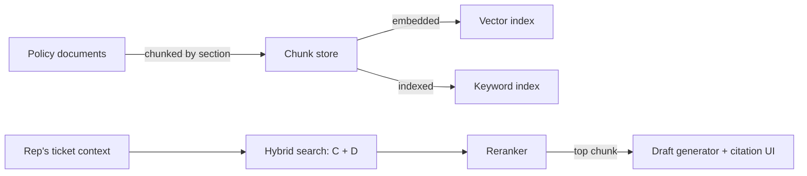

# RAG for Product Managers: Why Most "Bad AI Answer" Bugs Are Retrieval Bugs

> Retrieval quality caps answer quality — chunking, search strategy, and reranking decide whether the model ever had the right information in front of it, before it generates a single word.

*Scenario: Northbeam (fictional company). Illustrative, not based on any employer's data.*

## 1. Problem

Northbeam's support reps have a ticket-drafting assistant (built in earlier work): it drafts replies, tags tone, and flags low-confidence output for review. But the citations in those drafts point to whatever policy excerpt a rep happened to paste into the conversation. Nothing guarantees the pasted excerpt is correct, current, or even relevant — a rep in a hurry pastes the first section that looks close enough. The assistant's citation UI was built to earn trust, but the thing it's citing isn't reliably sourced yet. The problem isn't the model's writing — it's that nobody has solved what information the model gets to see.

## 2. Product decision

| Option | Why not / why chosen |
|---|---|
| Keep manual paste-in, improve the citation UI | Doesn't fix the root problem — a well-formatted citation of the wrong excerpt is still wrong |
| Vector search only over the policy library | Fails on exact-match lookups (policy numbers, error codes) that reps rely on daily — semantic similarity isn't built for literal strings |
| **Hybrid search (vector + keyword) with a reranking pass, auto-retrieved** | Catches both "what's the policy on late refunds" (semantic) and "policy 4.2.1" (exact) queries, and reranking filters the initial candidate pool down to the one chunk that actually answers the question |

Chosen: replace manual paste-in with automatic retrieval over Northbeam's policy documents, using hybrid search followed by a reranking step, with the top result feeding the existing draft-plus-citation UI unchanged.

## 3. How the system works

- **Chunking:** policy documents are split by section heading, not by a fixed character count — so a rule and its exception clause stay in the same chunk instead of being separated across a boundary.
- **Indexing:** each chunk is embedded for vector search and also indexed for keyword search, so both "meaning" queries and exact-term queries (error codes, policy numbers) have a path to the right chunk.
- **Retrieval:** a rep's ticket context triggers hybrid search across both indexes, returning a candidate set that neither search mode alone would have produced.
- **Reranking:** the candidates are reordered by a more precise relevance pass before anything reaches the draft generator — this is the step that turns "topically close" into "actually the right clause."
- **Output:** the single best-ranked chunk becomes the citation source feeding the existing draft-plus-citation UI — no change needed on the UI side, only on what feeds it.

## 4. Risks and trade-offs

- **Authoring overhead:** section-based chunking only works if source documents keep clean section structure — someone now owns maintaining that structure, not just the document's content.
- **Cost and latency:** hybrid search costs more to run than vector-only, and reranking adds a step to a flow reps expect to be fast. Speed built trust in the earlier version of this assistant; this change must not spend that down.
- **Freshness is a separate problem:** a perfectly retrieved chunk from an outdated policy document is still a wrong answer. Retrieval quality and content freshness are different failure modes with different fixes — this artifact only solves the first one.
- **False precision:** reranking can make a wrong-but-plausible chunk look more authoritative by ranking it first with confidence. A good reranker still needs a floor — low-confidence retrieval should route to "no confident source found," not a best-guess citation.

## 5. How I would measure success

- **North star:** retrieval precision — is the cited chunk actually the correct source, checked by periodic spot-audit against the real policy.
- **Supporting metric:** citation-correction rate — how often a rep edits or replaces the auto-cited excerpt, as a proxy for retrieval quality without requiring a manual audit every time.
- **Supporting metric:** exact-match catch rate — the share of error-code/policy-number queries hybrid search resolves correctly that a vector-only baseline would have missed.
- **Guardrail metric:** latency added to draft generation versus the pre-retrieval baseline — if this erodes response time past what reps tolerate, the trade-off isn't worth it regardless of precision gains.

---
**Related:** [`02-prompt-context-design/prompt-vs-context.md`](../02-prompt-context-design/prompt-vs-context.md) · [`02-prompt-context-design/contextual-ai-experience-design.md`](../02-prompt-context-design/contextual-ai-experience-design.md)
