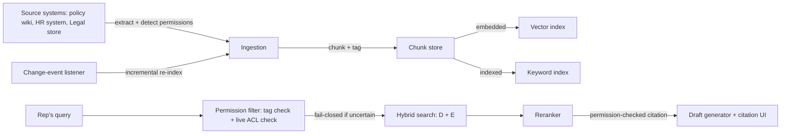

# RAG System Design: Ingestion, Freshness, and Permissions Aren't Optional Extras

> A retrieval pipeline that nails relevance but skips freshness and permissions is still an incident waiting to happen — ingestion, sync, and access control are separate systems with separate failure modes, not footnotes to search quality.

*Scenario: Northbeam (fictional company). Illustrative, not based on any employer's data.*

## 1. Problem

Day 8 fixed Northbeam's ticket-drafting assistant so it retrieves the right policy chunk instead of relying on a rep to paste one in. But the policy library behind that retrieval was built ad hoc: documents get added to the index whenever someone remembers to run the ingestion script, there's no defined re-sync cadence, and nothing enforces who is allowed to see what. That was tolerable while the index only held general support policies. It stops being tolerable now that Northbeam is expanding the same library into HR- and Legal-adjacent documents — disciplinary policy, contract templates — that most reps have no business reading. Retrieval can be mathematically perfect and still return a chunk from a document the requesting rep isn't permitted to see, or confidently cite a policy that was revoked last week. Those are two different failures, and neither is a search-quality problem.

## 2. Product decision

| Option | Why not / why chosen |
|---|---|
| Nightly full re-index, no permission filtering, manual curation keeps sensitive docs out | Doesn't scale — one missed document during ingestion is a silent leak, and manual curation has no way to catch it before a rep's query does |
| Chunk-level permission tags set at ingestion, synced on a schedule | Fast at query time, but tags can drift out of sync with real permissions between syncs — a rep whose access was just revoked keeps seeing tagged-as-OK chunks until the next sync |
| **Permission-aware retrieval: ingestion tags as a fast first pass, plus a live ACL check against the source system before anything is returned, fail-closed by default; incremental re-index on change events with nightly full re-index as a backstop** | Catches both problems — tags narrow the candidate set cheaply, the live check catches anything the tags got wrong or missed, and fail-closed means an uncertain permission check excludes a chunk rather than risking exposure |

Chosen: the third option. Ingestion tags do the cheap filtering; a query-time ACL check is the enforcement layer that's actually trusted, and it defaults to exclusion whenever it can't confirm access.

## 3. How the system works

- **Ingestion:** source documents are extracted, their access scope is detected from the source system (not guessed from content), and they're chunked and tagged with that permission metadata.
- **Freshness:** a change-event listener on each source system triggers incremental re-indexing of just the changed document; a nightly full re-index runs as a backstop for any system without reliable change events.
- **Permission filter (the enforcement layer):** before hybrid search ever runs, a rep's query is filtered against both the ingestion-time tag (cheap, can be stale) and a live check against the source system's current ACL (authoritative, adds latency). Any chunk the live check can't confirm is excluded — fail-closed, never fail-open.
- **Retrieval and reranking:** unchanged from Day 8 — hybrid search plus reranking, now running only over the permission-cleared candidate set.
- **Citation:** the link shown to the rep passes the same live ACL check as retrieval, so "cited" and "clickable" can never diverge.

## 4. Risks and trade-offs

- **Latency:** a live ACL check on every query adds a round-trip to the source system, on top of the hybrid-search-plus-reranking cost Day 8 already introduced. Enough of these stack up and the assistant stops feeling instant.
- **Tag drift:** ingestion-time permission tags are a convenience, not a source of truth — if the live check is ever skipped for speed, a rep whose access changed since the last sync can see something they shouldn't.
- **Change-detection coverage:** incremental re-indexing only works where the source system actually emits reliable change events. Where it doesn't, freshness quietly degrades to "whenever the nightly job runs," and nobody notices until a stale answer surfaces.
- **Document retirement is a process gap, not an engineering one:** nothing in this design decides when a revoked or outdated document gets removed from the index — that ownership has to sit with someone, or stale documents linger indefinitely.

## 5. How I would measure success

- **North star:** permission-leak rate — target zero, verified by periodic audit of what chunks were actually served against what the requesting rep was entitled to see.
- **Supporting metric:** freshness lag per content type — how far behind the source system the index runs, measured separately for event-driven and nightly-batch content.
- **Supporting metric:** citation-open-success rate — can the rep actually open what was cited, carried over from Day 8's framing but now also a permission-consistency check.
- **Guardrail metric:** latency added by the permission filter — if the live ACL check pushes response time past what reps tolerate, that's a real cost against the leak-prevention benefit, not a free safety feature.

---
**Related:** [`03-rag-knowledge-retrieval/rag-for-product-managers.md`](rag-for-product-managers.md) · [`02-prompt-context-design/contextual-ai-experience-design.md`](../02-prompt-context-design/contextual-ai-experience-design.md)
