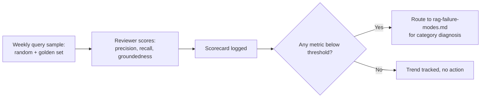

# Retrieval Quality Scorecard: Measuring RAG Before a Complaint Does It For You

> Rep complaints are a lagging, biased signal — loud users report, quiet failures don't; a lightweight weekly scorecard on precision, recall, and groundedness makes retrieval quality visible on a schedule the team controls, not the schedule a frustrated rep sets.

*Scenario: Northbeam (fictional company). Illustrative, not based on any employer's data.*

## 1. Problem

Hybrid search, reranking, and permission-aware retrieval have all shipped (Days 8-9), but there's no standing way to tell if any of it is actually working over time — the only signal is rep complaints, which are slow to surface, skewed toward whoever is most vocal, and (per the companion failure-modes taxonomy) don't distinguish *why* an answer was bad. By the time a pattern of complaints adds up to "something regressed," the regression has already been live for a while.

## 2. Product decision

| Option | Why not / why chosen |
|---|---|
| Wait for the full evaluation framework (Day 16) before measuring anything | Right destination, wrong timing — that's weeks away, and the system ships blind in the meantime |
| Rely on rep-reported complaints only | Lagging and biased, and gives no way to separate retrieval-miss from ranking-failure from staleness |
| **Stand up a lightweight weekly scorecard now: a small sampled query set, scored by a rotating human reviewer against three core metrics, formalized later once Day 16 exists** | Cheap to start, gives a trend line immediately, and hands Day 16 a running dataset and rubric to build on instead of starting from nothing |

Chosen: the lightweight scorecard. It is explicitly a bridge, not a permanent solution — Day 16's evaluation framework should absorb or replace it, not duplicate it from scratch.

## 3. How the system works

Three metrics, each answering a different question:

| Metric | What it answers | How it's measured |
|---|---|---|
| **Precision@k** | Of the top-k retrieved chunks, how many are actually relevant? | Human reviewer scores a weekly sample of real queries against a simple relevant/not-relevant rubric |
| **Recall (proxied)** | Did retrieval surface the correct source at all? | A small "golden query set" with a known correct document is run every week; recall is the share retrieval actually found |
| **Groundedness** | Does the generated draft's claims actually trace back to the retrieved/cited chunk? | Reviewer checks the draft against its citation — catches hallucination even when retrieval itself was fine |

Any metric crossing a threshold routes directly into the failure-mode taxonomy — the scorecard flags *that* something's wrong; the taxonomy is still what diagnoses *why*.

## 4. Risks and trade-offs

- **Manual scoring doesn't scale and isn't automatically consistent** — without a shared rubric, two reviewers can score the same sample differently, and the trend becomes noise instead of signal.
- **Small sample size misses rare-but-severe failures.** A permission leak (Day 9) is exactly the kind of failure a weekly sample can miss entirely — that needs a separate audit process, not sampling, because its acceptable rate is zero, not "mostly fine."
- **Becomes theater if nobody acts on a declining trend.** A scorecard is only as useful as the habit of actually investigating a dip — logging a number nobody reviews is worse than not logging it, because it creates false confidence that quality is being watched.

## 5. How I would measure success

- **North star:** the scorecard catches a real regression *before* it shows up as a rep complaint — the whole point is moving the signal earlier.
- **Supporting metric:** inter-rater consistency — if two reviewers score the same sample and land far apart, the rubric isn't tight enough to trust the trend line yet.
- **Guardrail:** time-to-diagnosis once a metric crosses threshold — a scorecard that flags a problem but still takes a week to route to the right fix hasn't actually saved any time.

---
**Related:** [`03-rag-knowledge-retrieval/rag-failure-modes.md`](rag-failure-modes.md) · [`03-rag-knowledge-retrieval/rag-system-design.md`](rag-system-design.md)
