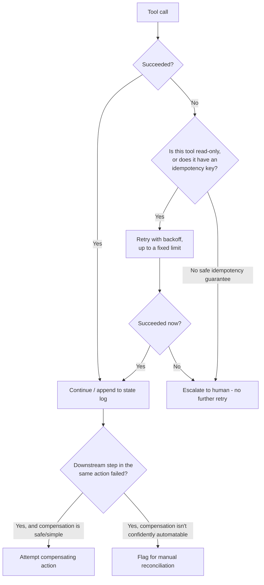

# Agent Failure and Recovery: Permissioning, Retries, and Rollback

> An agent design that only specifies the happy path isn't finished — the real test is what happens when a tool call times out halfway through a side effect, and "retry everything" or "retry nothing" are both wrong answers applied to every tool.

*Scenario: Northbeam (fictional company). Illustrative, not based on any employer's data.*

## 1. Problem

Day 12 gave Northbeam's ticket-triage agent narrow tools, an audit log, and a bounded tool-call loop — but it assumed every tool call either cleanly succeeds or cleanly fails. Reality is messier: a `check_credit_eligibility` call can time out after partially executing, a `create_escalation` call can succeed on the backend but fail to return confirmation to the agent, and nothing in the Day 12 design says what happens next. Left unaddressed, the agent either stops entirely and loses the ticket, or — worse — keeps reasoning as if a call succeeded when it didn't, producing a confidently wrong resolution on top of a silent failure.

## 2. Product decision

| Design question | Options considered | Chosen |
|---|---|---|
| **Retry policy** | Retry every failed call the same way up to N times, vs. no retries at all, vs. a per-tool policy | Per-tool policy: read-only tools (`lookup_account`) retry safely; side-effecting tools (`create_escalation`) retry only with an idempotency key; anything without a safe idempotency guarantee escalates immediately, no retry |
| **Permissioning** | Each tool runs with the agent's full access, vs. each tool call scoped to the minimum credential it needs | Minimum scope per call — `create_escalation`'s credential can create a ticket and nothing else, even though the agent's broader task touches account and billing-adjacent data |
| **Partial failure handling** | Leave a partially-completed action as-is, vs. attempt an automated compensating action, vs. flag for manual reconciliation | Attempt compensation where it's itself safe and simple (e.g., retry the "mark resolved" step); flag for manual reconciliation where compensation isn't confidently automatable — never leave it silently half-done |

## 3. How the system works

- **Retries are tool-specific, not blanket.** A lookup can be retried freely because repeating it has no side effect. A side-effecting tool is only retried if it carries an idempotency key the backend can use to recognize "this is the same request I already processed" — without that guarantee, a retry risks a duplicate credit or a duplicate escalation ticket, which is worse than the original failure.
- **Permissioning is per-call, not per-agent.** Each tool's credential is scoped to exactly what that tool needs to do — this limits the damage of any single misfiring or misused call, independent of whether the failure was the agent's reasoning or the tool's own bug.
- **Partial failure gets a decision, not silence.** If one step of a multi-step action succeeds and a later step fails, the system either runs a safe compensating step or explicitly flags the case for a human to reconcile — it never just stops and leaves the record in an ambiguous state.

## 4. Risks and trade-offs

- **Idempotency keys are real engineering cost** — every side-effecting tool needs one designed and tested, not just added as an afterthought; skipping this for one tool to save time reintroduces the exact duplicate-action risk the design exists to prevent.
- **Misclassifying a tool as retry-safe is a dangerous bug, not a minor one** — if a tool without a real idempotency guarantee gets treated as safe to retry, the failure mode is silent duplication, which is harder to notice than an outright error.
- **Compensating actions can themselves fail**, creating a second-order recovery problem — the design doesn't eliminate this risk, it only makes sure a failed compensation is visible (manual reconciliation) rather than silently dropped.
- **Defaulting to escalation on every unsafe failure can overwhelm reviewers if the underlying failure rate is high** — that's a signal to fix reliability upstream, not a reason to loosen the no-retry rule for unsafe tools just to reduce escalation volume.

## 5. How I would measure success

- **North star:** duplicate-action rate — target zero; this is the hard constraint retry policy and idempotency design exist to protect, not a metric to trade off against convenience.
- **Supporting metric:** mean time to detect a partially-failed or stuck run — the gap between a failure happening and a human (or the system) noticing it needs reconciliation.
- **Guardrail metric:** escalation rate attributable specifically to tool failure, tracked separately from escalation due to genuine ticket complexity (same separation introduced in Day 12) — a rising failure-driven rate is a reliability regression, not a triage-design problem, and should be routed to the team that owns the failing tool's integration.

---
**Related:** [`04-agentic-workflows/agent-tool-use-system-design.md`](agent-tool-use-system-design.md)
