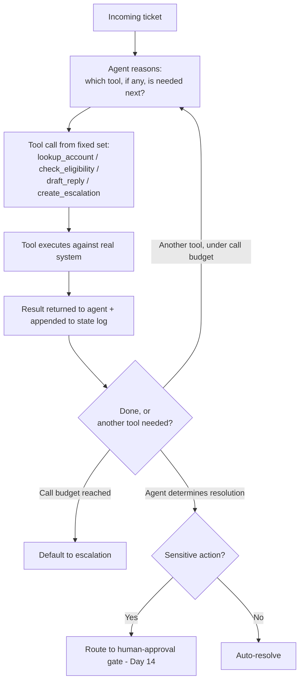

# Agent Tool-Use System Design: Tools, Memory, State, and Planning

> "Let the LLM decide what to do" isn't a system design — without a defined tool surface, bounded planning, and an explicit state log, an agent either can't take any real action or takes actions nobody can predict, audit, or roll back.

*Scenario: Northbeam (fictional company). Illustrative, not based on any employer's data.*

## 1. Problem

Day 11 flagged a genuine agent case: a ticket-triage agent that decides, per ticket, whether to resolve it automatically, escalate it, or ask the customer a clarifying question — unlike the fixed-workflow credit case, this path genuinely can't be predicted in advance. But "the agent decides" only describes the ambition, not the system. Without a defined set of tools, a bounded way to plan multi-step action, and a record of what actually happened, the agent either stays harmlessly inert (it can reason but can't act on anything real) or gets wired up to raw systems in a way nobody can predict, debug, or audit after the fact.

## 2. Product decision

| Design question | Options considered | Chosen |
|---|---|---|
| **Tool surface** | One broad "do anything" tool with raw API/database access, vs. a small set of narrow, purpose-built tools (`lookup_account`, `check_credit_eligibility`, `draft_reply`, `create_escalation`) | Narrow tools — a broad tool gives the agent the same unconstrained power as no tool design at all, defeating the point |
| **Memory** | Persistent memory across tickets (the agent "remembers" past customers/cases), vs. session-scoped working memory only | Session-scoped only — cross-ticket memory raises privacy and correctness risk (stale context bleeding into an unrelated case) without a clear benefit for triage |
| **State tracking** | Rely on the model's internal reasoning trace as the record of what happened, vs. an explicit, append-only log of every tool call and result | Explicit state log — a reasoning trace isn't a reliable system-of-record; it can be inconsistent with what actually executed |
| **Planning** | Unbounded iterative reasoning (the agent keeps going until it decides it's done), vs. a bounded loop with a fixed maximum number of tool calls | Bounded loop — caps runaway cost and unpredictable behavior; hitting the cap routes to escalation, not an unlimited retry |

## 3. How the system works

- **Tools:** each tool has a constrained input/output schema mapped to one real system action — no tool is broad enough to do more than its name implies, which keeps the agent's possible actions enumerable and reviewable in advance, even though the *order* of calls isn't fixed.
- **Memory:** working memory lives only within one ticket's run; nothing persists to the next ticket, so the agent can't carry stale or cross-customer context forward.
- **State:** every tool call and its result is appended to a log tied to the ticket, independent of the model's own narration of what it did — this is what makes the run auditable after the fact.
- **Planning:** the agent iterates tool calls up to a fixed budget per ticket; exceeding the budget is itself a signal (the case is more complex than triage assumed) and routes to escalation by default, not to more attempts.

## 4. Risks and trade-offs

- **Tool scope creep:** the value of narrow tools erodes quickly if each one quietly grows more parameters and more power over time — a `draft_reply` tool that gradually gains a `send_immediately` flag has become something else without anyone redesigning it as such.
- **Latency:** each tool round-trip adds time; a ticket needing four sequential tool calls is slower than the single-shot workflow from Day 11 — the flexibility this design buys has a real cost, not a free one.
- **Bounded planning can cut off legitimate complexity:** a case that genuinely needs five tool calls hits the cap and gets escalated even though it was resolvable — that's an intentional trade (fail safe to a human) not a flaw to silently raise the cap away.
- **State log overhead becomes useless if nobody reviews it:** logging every call is only valuable if it's actually used to audit outcomes and diagnose failures — an unread log is just storage cost.

## 5. How I would measure success

- **North star:** audit completeness — can every agent action be fully reconstructed from the state log, independent of the model's own explanation of what it did.
- **Supporting metric:** share of tickets resolved within the tool-call budget without hitting the cap — a declining share signals the task's real complexity is outgrowing the bounded design.
- **Supporting metric:** tool-level error rate — calls that fail or return an unexpected shape, which point at integration problems distinct from the agent's reasoning.
- **Guardrail metric:** escalation rate attributable to the call-budget cap specifically, tracked separately from escalations caused by genuine ticket complexity — conflating the two would hide whether the budget itself needs revisiting.

---
**Related:** [`04-agentic-workflows/workflow-vs-agent.md`](workflow-vs-agent.md)
