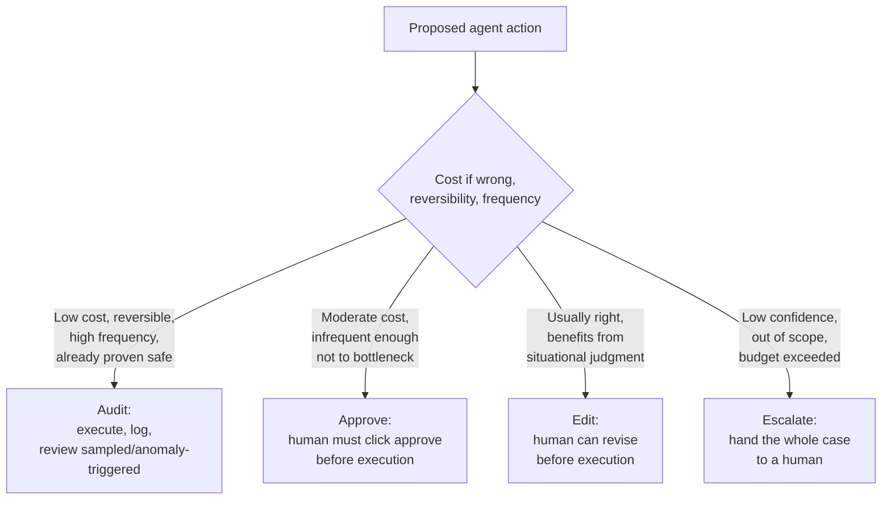

# Human Approval Patterns: Approve, Edit, Escalate, Audit Aren't the Same Thing

> "Put a human in the loop" sounds like one safety answer, but it's actually four different patterns with different costs and different risks — applying the wrong one either kills the automation's value or removes a check exactly where it was needed.

*Scenario: Northbeam (fictional company). Illustrative, not based on any employer's data.*

## 1. Problem

Northbeam wants the ticket-triage agent (Days 12-13) to actually resolve tickets — including applying credits — not just draft and hand everything to a rep. The team's default answer to "is this safe" is "put a human in the loop," but that phrase covers at least four genuinely different designs: a human can approve before anything happens, edit a draft before it executes, take the whole case over (escalate), or review what already happened after the fact (audit). Applying one pattern everywhere either bottlenecks every low-risk action behind a human reviewer, or removes oversight from exactly the action that most needed it.

## 2. Product decision

| Pattern | What it means | When it's the right fit |
|---|---|---|
| **Approve** | A human reviews the proposed action and must click approve before it executes | Costly-to-reverse, infrequent-enough-not-to-bottleneck actions — e.g., a credit between $15-$50 decided by the agent's judgment rather than a fixed rule |
| **Edit** | A human can modify the proposed action's details before it executes, not just accept or reject it | Actions that are usually mostly right but benefit from situational judgment — e.g., an escalation ticket's summary or priority level |
| **Escalate** | The agent stops entirely; a human takes over the whole case, not just one action | Low confidence, out-of-scope cases, or the Day 13 tool-call budget exceeded — this is "a human now owns this case," not a lighter version of approve |
| **Audit** | The action executes automatically; a human reviews it after the fact, sampled or anomaly-triggered | Low-risk, highly reversible, high-frequency actions already proven safe elsewhere — e.g., the ≤$15 fixed-rule credit from Day 11's deterministic workflow |

Chosen: map each action type to a pattern based on **(cost of being wrong) × (reversibility) × (frequency)**, instead of one "human in the loop" policy applied uniformly across every action the triage agent can take.

## 3. How the system works

Applied to the triage agent: the ≤$15 fixed-rule credit (already a deterministic workflow per Day 11) runs on audit — requiring approval on every instance would erase the automation's value for a case already proven safe. The $15-$50 judgment-based credit requires approve, since it's the agent's own reasoning deciding, not a fixed rule. Draft escalation tickets go through edit, since a rep's two-second adjustment to severity is faster and better than a reject-and-redo cycle. Anything hitting the Day 13 tool-call budget, or falling outside the agent's defined scope, escalates — full handoff, not a lighter check.

## 4. Risks and trade-offs

- **Approve everywhere causes approval fatigue.** If a reviewer sees mostly-correct proposals constantly, they learn to click approve without really reviewing — the pattern becomes theater exactly where it was meant to be a real check.
- **Audit everywhere risks irreversible harm before anyone notices.** A bad action under an audit pattern has already happened by the time a human reviews it — this pattern only belongs on actions where that's an acceptable risk.
- **Edit can quietly hide a systemic agent error.** If a human keeps correcting the same kind of mistake in the agent's drafts, "edit" fixes each instance without ever surfacing that the underlying drafting logic is wrong — a high recurring-edit rate on the same correction is a bug report hiding in plain sight, not business as usual.
- **A high escalation rate erodes the agent's value and signals a scoping problem**, not a working safety net — if most cases escalate, the agent isn't actually automating triage, and the fix is revisiting scope, not accepting the escalation volume as the cost of safety.

## 5. How I would measure success

- **North star:** no irreversible harm occurs under the audit pattern — checked by whether audit sampling ever finds a real problem at a non-trivial rate; if it does, that action tier needs to move back toward approve, not stay on audit.
- **Supporting metric:** approve-pattern approval rate over time — a rate drifting toward "almost always approved, never rejected" is an approval-fatigue warning sign, not evidence the agent has gotten reliably better.
- **Supporting metric:** recurring-correction rate within the edit pattern — the same correction showing up repeatedly means the fix belongs in the agent's drafting logic, not in every human's edit each time.
- **Guardrail metric:** escalation rate trend — should decline as scope-fit improves; a flat or rising rate means the agent's assumed scope doesn't match the real ticket mix.

---
**Related:** [`04-agentic-workflows/agent-failure-and-recovery.md`](agent-failure-and-recovery.md) · [`04-agentic-workflows/workflow-vs-agent.md`](workflow-vs-agent.md)
