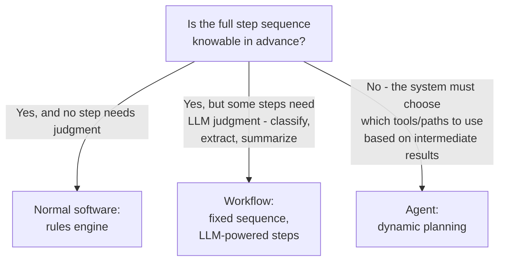

# Should This Be an Agent, a Workflow, or Normal Software?

> "Agent" is the exciting word, not the right default — the question is whether the sequence of steps is knowable in advance, and reaching for autonomy on a task that doesn't need it trades predictability for a capability nobody asked for.

*Scenario: Northbeam (fictional company). Illustrative, not based on any employer's data.*

## 1. Problem

Northbeam wants the ticket-drafting assistant (Days 6-10) to go further than drafting — resolve some routine tickets end-to-end instead of leaving every step to a rep. The first candidate: late-shipment complaints under a fixed dollar threshold get a standard credit, with no judgment call beyond confirming the ticket actually qualifies. The team's instinct is to call this "an agent," because that's the term everyone's using for the next wave of AI features. But what to build is a system-design decision, not a naming decision, and conflating the two risks building something riskier and harder to audit than the task actually requires.

## 2. Product decision

| Option | Why not / why chosen |
|---|---|
| **Normal deterministic software** (rules engine: if ticket matches fixed criteria, apply the fixed credit) | No LLM involved at all — viable where eligibility is a simple rule, but this case involves unstructured ticket text that needs extraction/classification first, which a rules engine alone handles poorly |
| **Fixed workflow** (a predetermined sequence of steps — classify ticket → check eligibility → draft credit memo → apply — with an LLM doing the judgment-heavy steps inside that fixed sequence) | **Chosen.** The sequence itself is fully knowable in advance; only individual steps (reading the ticket, deciding if it matches the criteria) benefit from LLM flexibility |
| **Agent** (the LLM decides at runtime which tools to call, in what order, based on open-ended reasoning about the ticket) | Overkill for a narrow, repeatable, low-variance task — dynamic planning adds unpredictability and failure surface without adding capability this task actually needs |

Chosen: a fixed workflow with LLM-powered steps, not an agent. The reasoning generalizes past this one feature: reserve "agent" for tasks where the *path itself* can't be fixed in advance, not for every task that happens to use an LLM somewhere inside it.

## 3. How the system works

The deciding question is whether the step sequence is knowable before the system runs, not whether an LLM is involved:

For Northbeam's credit-eligibility case: the sequence — classify ticket type, extract shipment details, check against the fixed eligibility rule, draft the credit memo, apply it — never changes. An LLM does the classification and extraction because ticket text is unstructured, but it never decides *which steps to run* or *in what order*; that's fixed by the workflow definition, which is exactly what keeps the whole thing auditable.

## 4. Risks and trade-offs

- **Mislabeling risk:** calling this a workflow "an agent" for the narrative value creates expectations of autonomy and flexibility it doesn't actually have — and sets up a confusing conversation later when a real agent is built and behaves differently.
- **Under-building risk:** if a future case genuinely needs dynamic path selection (which tool to call depends on what the previous step found), forcing it into a fixed workflow produces brittle special-case branches that accumulate instead of a system designed for the variability.
- **Over-building risk (the one that applies here):** giving a narrow, repeatable, low-risk task agent-style autonomy adds unpredictability, harder debugging, and a bigger guardrail/approval surface — for a task that doesn't benefit from any of that flexibility.
- **Auditability trade-off:** a fixed workflow's path can be fully predicted and reviewed before it ever runs; an agent's dynamically chosen path can only be reviewed after the fact. For anything touching money (a credit, in this case), that difference matters more than the appeal of "smarter" autonomy.

## 5. How I would measure success

- **North star:** can the full decision path be predicted and audited *before* the system runs, for every input in scope — a yes confirms workflow was the right call; if the answer becomes "no" as scope grows, that's the signal an agent might actually be warranted.
- **Supporting metric:** outcome variance for repeated, near-identical inputs — a workflow should show near-zero variance; rising variance on inputs that should resolve identically is a sign something is behaving more like an (unintended) agent than the design assumes.
- **Guardrail metric:** rate of tickets that fall outside the fixed sequence's assumptions (e.g., a credit request that doesn't cleanly classify) — a high rate means the task's real shape doesn't match "fixed sequence" anymore, and the design question should be revisited, not patched around.

---
**Related:** [`03-rag-knowledge-retrieval/rag-failure-modes.md`](../03-rag-knowledge-retrieval/rag-failure-modes.md)
