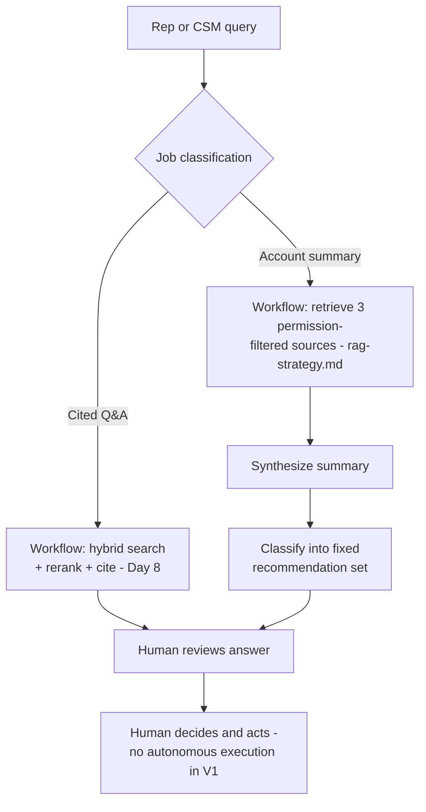

# Enterprise Knowledge Assistant: Agent/Tool Design

> Week 3 built an agent for Northbeam because it took real actions — but Ridgeline's V1 explicitly doesn't: "a human decides and acts" was decided on Day 5, and applying the agent framework honestly here means confirming both V1 jobs are workflows, not agents, and getting the Week 3 complexity that comes with real actions for free until V1 actually needs it.

*Scenario: Ridgeline Software, a mid-market B2B SaaS company. Illustrative, not based on any employer's data.*

Third artifact in the capstone. Builds on [`problem-and-users.md`](problem-and-users.md)'s explicit V1 boundary — "no autonomous actions... human decides and acts" — and [`rag-strategy.md`](rag-strategy.md)'s retrieval design, applying Week 3's workflow/agent/tool/recovery/approval frameworks to confirm what V1 actually needs, not what Week 3's Northbeam agent happened to need.

## 1. Problem

Week 3 built a genuine agent for Northbeam because its triage task took real actions — applying credits, creating escalation tickets — with a path that couldn't be fixed in advance. The instinct going into this capstone is to reach for the same "give it tools and let it plan" pattern. But Day 5's scoping already drew a hard line: Ridgeline's V1 takes no autonomous actions at all; every job ends in a recommendation a human reviews and acts on manually. Applying Week 3's agent machinery here without checking that boundary would mean quietly re-scoping V1 mid-capstone instead of building what was actually committed to.

## 2. Product decision

Apply the Day 11 test — *is the full step sequence knowable in advance?* — to each job explicitly, rather than assuming "assistant with tools" means agent by default:

| Job | Sequence knowable in advance? | Verdict |
|---|---|---|
| **Cited Q&A** (retrieve → cite → answer) | Yes — fixed sequence, no path choice | **Workflow** |
| **Account summary + recommendation** | Yes — the three sources to check are fixed, and the recommendation is chosen from a small, fixed set (e.g., *schedule a call*, *escalate to CSM lead*, *send a proactive update*, *no action needed*), not an open-ended action space | **Workflow** |

Chosen: both V1 jobs are workflows with LLM-powered steps (summarization, classification into the fixed recommendation set) — not agents. This isn't a compromise; it's what Day 5's "recommend, don't act" decision actually implies once the Day 11 test is applied honestly. Agent-style dynamic tool choice stays deferred to a hypothetical V2 that takes real actions — it isn't needed, and isn't built, now.

## 3. How the system works

**Tools:** every tool in V1 is read-only — `get_product_docs`, `get_policy_docs`, `get_ticket_history`, `get_release_notes`, `get_csm_notes` — each narrow and source-specific (Day 12's pattern), each permission-scoped to the requester's role per source. No write or action tool exists anywhere in V1.

**Failure recovery (Day 13), simplified:** because every tool is read-only, every one is safe to retry freely — no idempotency key design is needed. This is a direct, visible payoff of Day 5's "recommend, don't act" decision: it eliminates an entire category of design work (idempotency, rollback, partial-failure compensation) that Northbeam's action-taking agent couldn't avoid.

**Approval pattern (Day 14), simplified:** approve/edit/escalate don't apply in their Day 14 form, because no action executes automatically for any of those patterns to gate. The fit here is closer to audit in spirit but not sampled — the human reviews *every* recommendation before deciding whether to act, by design, because "a human decides and acts" is V1's entire safety model, not an optional layer on top of one.

## 4. Risks and trade-offs

- **This simplicity is scope-dependent, not permanent.** The moment V1 grows an action — even something modest, like drafting an email for a CSM to send — Day 13's idempotency and Day 14's approval-pattern design become necessary again. This doc's clean result shouldn't be read as "Ridgeline doesn't need agentic design," only as "this exact V1 scope doesn't yet."
- **A fixed recommendation set can force a poor fit.** Classifying every account situation into one of four options risks quietly forcing a close-but-wrong recommendation on real cases that don't fit any of them well, instead of surfacing "none of these fit, use judgment" as a valid output.
- **Read-only tools still carry permission risk**, even with no action to approve — a CSM-notes retrieval reaching the wrong requester is still the Day 9 failure mode (permission leak), just without an action compounding it.

## 5. How I would measure success

- **North star:** permission-leak rate on CSM-only sources — target zero, same non-negotiable floor as the RAG strategy doc, now checked specifically through the tool layer rather than retrieval alone.
- **Supporting metric:** rate at which a CSM overrides or ignores the recommended next step rather than accepting it as given — a high override rate is the signal the fixed recommendation set doesn't cover real cases well, not a reason to force more cases into it.
- **Guardrail metric:** the day this changes — the first time a V1+ feature proposes an actual action (not just a recommendation), that's the explicit trigger to revisit this doc and bring Day 13/14's full machinery back in, rather than letting action-taking creep in without the design catching up.

---
**Related:** [`problem-and-users.md`](problem-and-users.md) · [`rag-strategy.md`](rag-strategy.md) · [`../../04-agentic-workflows/workflow-vs-agent.md`](../../04-agentic-workflows/workflow-vs-agent.md) · [`../../04-agentic-workflows/human-approval-patterns.md`](../../04-agentic-workflows/human-approval-patterns.md)
