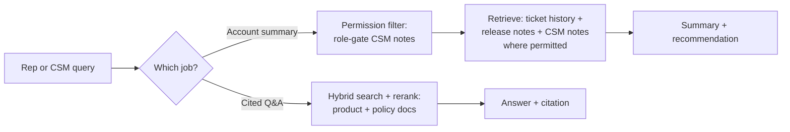

# Enterprise Knowledge Assistant: RAG Strategy

> The V1 jobs aren't equally sensitive — a cited product/policy answer draws from low-risk shared sources, but an account summary pulls in CSM-only notes, so retrieval needs a permission line drawn into the design itself, not assumed away because "it's all internal."

*Scenario: Ridgeline Software, a mid-market B2B SaaS company. Illustrative, not based on any employer's data.*

Second artifact in the capstone. Builds directly on [`problem-and-users.md`](problem-and-users.md)'s V1 scope: Support reps and CSMs, two jobs ("cited answer to a product/policy question" and "account summary + recommended next step"), three knowledge sources (product docs, policy docs, resolved tickets) plus CSM-only notes for the account-summary job — this doc applies Week 2's RAG lessons to that exact scope, not a hypothetical broader one.

## 1. Problem

Problem-and-users.md scoped *who* and *what*, but said nothing about *how retrieval respects who's asking*. The three V1 sources aren't equally sensitive: product and policy docs are meant for both support reps and CSMs equally, but the account-summary job pulls in CSM-only notes that reps shouldn't see. Nothing in the scope doc yet draws that line into the retrieval design — and this is exactly the kind of gap that stayed theoretical for Northbeam's assistant until Day 9 forced the issue. Here, it's better to design it in from the start than to retrofit it after a leak.

## 2. Product decision

| Option | Why not / why chosen |
|---|---|
| One shared index across all sources, visible to both reps and CSMs | Simplest to build, but repeats the exact mistake problem-and-users.md already flagged about contracts/finance one tier down — permissioning can't be an afterthought |
| Keep CSM notes out of the assistant entirely | Safest, but throws away the account-summary job's most distinctive source — the job explicitly needs it, and the risk is manageable with permission-aware retrieval already proven on Northbeam |
| **Separate retrieval per source, permission-filtered by requester role** (ingestion tags + live role check, fail-closed — the Day 9 pattern, reused rather than reinvented) | Lets the account-summary job use CSM notes without exposing them to reps, and reuses a pattern already validated instead of designing a new one from scratch |

Chosen: the third option. Retrieval is source-aware and role-aware from day one, not added after a leak surfaces.

## 3. How the system works

**Job 1 — cited product/policy answer:** hybrid search plus reranking (Day 8) across product and policy docs only. Both sources are equally visible to reps and CSMs, so no permission filter is needed here beyond standard access.

**Job 2 — account summary + recommended next step:** retrieval spans three sources with different audiences — ticket history (support-visible), release notes (general), and CSM notes (CSM-only). The Day 9 permission filter gates CSM notes to CSM requesters, fail-closed by default; ticket history and release notes sync more frequently (active accounts change often) while CSM notes sync on whatever cadence the CSM tooling actually supports.

Both jobs route through the Day 10 failure-mode taxonomy and a lightweight scorecard for ongoing monitoring — scored **separately per job**, not blended into one number, since job 2's three-source mix is structurally harder than job 1's two-source case.

## 4. Risks and trade-offs

- **Reused pattern assumes a checkable ACL.** Day 9's live permission check assumes the source system exposes something to check against — if Ridgeline's CSM-notes tool doesn't have a clean permissions API, the live-check half of this design is a real integration risk, not just a design choice, and may need to fall back toward tag-only enforcement with its known drift risk.
- **Context overload is a bigger risk for job 2.** Pulling from three heterogeneous sources at once raises the Day 10 context-overload failure mode more than job 1's simpler two-source retrieval — summaries risk burying the recommendation-relevant detail in noise.
- **A blended scorecard would hide job 2's harder baseline.** If precision/recall/groundedness are tracked as one combined number, job 1's easier two-source case can mask real problems in job 2's three-source synthesis.

## 5. How I would measure success

- **North star (carried over, non-negotiable):** permission-leak rate — target zero, now checked across two jobs instead of one, since CSM notes are new exposure surface this capstone introduces.
- **Supporting metrics:** precision, proxied recall, and groundedness (Day 10's scorecard), tracked separately for Job 1 and Job 2.
- **Supporting metric:** citation-open-success rate for Job 1 specifically, since that job's entire trust model depends on the rep being able to actually open what's cited.

---
**Related:** [`problem-and-users.md`](problem-and-users.md) · [`../../03-rag-knowledge-retrieval/rag-system-design.md`](../../03-rag-knowledge-retrieval/rag-system-design.md) · [`../../03-rag-knowledge-retrieval/retrieval-quality-scorecard.md`](../../03-rag-knowledge-retrieval/retrieval-quality-scorecard.md)
